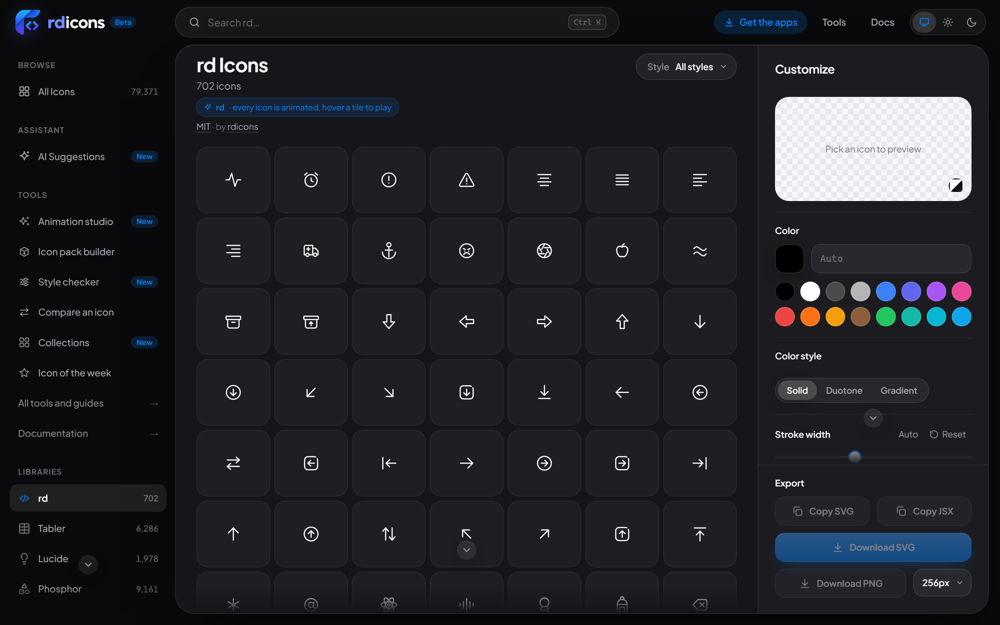
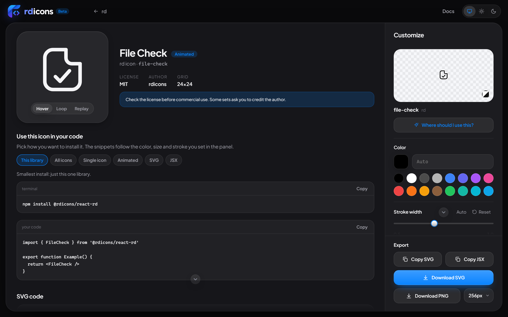
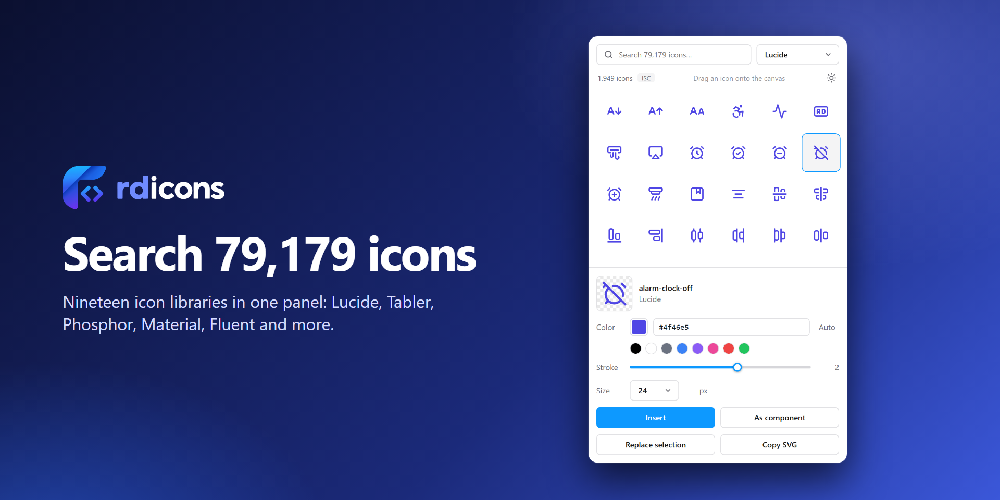

<p align="center">
  
  
</p>

<p align="center">
  <a href="https://rdicons.vimalbhatt.com/library/rd"><b>Browse online</b></a> ·
  <a href="https://rdicons.vimalbhatt.com/download/desktop">Desktop app</a> ·
  <a href="#6-figma-plugin">Figma plugin</a> ·
  <a href="#use-it">Use it</a> ·
  <a href="#animation">Animation</a> ·
  <a href="#all-icons-by-category">All icons</a>
</p>

<p align="center">
  
  
  
  
  
</p>

**rd** is a free line-icon library: **622 icons** on a 24 × 24 grid, drawn with a 1.5 px stroke, round caps and joins, and one signature detail: shapes that hold something (a folder, a window, a card, a calendar) keep a small **open corner at the top right**. Every icon has a built-in animation.

- **Free for everything.** MIT license, personal and commercial, no attribution needed.
- **Adjustable by design.** A light default stroke, so you can make it bolder or thinner in CSS, Figma or code.
- **Alive.** All 622 icons animate: strokes draw in, lids lift, steam rises, eyes blink. Pure CSS, no JavaScript, reduced-motion aware.
- **Light.** An average of 292 bytes per icon; the whole set is 23.0 KB gzipped.

<p align="center">
  
  
</p>

## Animated preview

These icons are looping right now (a CSS animation inside the SVG, no GIF):

<p align="center">
  
  
</p>

## See it in use

<p align="center"></p>

The library page lets you search, change colour, stroke width and size, then copy or download any icon as SVG, PNG or React.

<p align="center"></p>

## Use it

### 1. Copy an SVG

Every icon is a plain file in [`svg/`](svg). They use `currentColor`, so they take the text colour of the page.

```html
<!-- a static icon -->


<!-- or paste the file inline and colour it with CSS -->
<svg viewBox="0 0 24 24" fill="none" stroke="currentColor" stroke-width="1.5" stroke-linecap="round" stroke-linejoin="round" style="color:#4f46e5"> … </svg>
```

### 2. Copy an animated SVG

The files in [`svg-animated/`](svg-animated) carry their own CSS. Paste one into your page and it plays when you hover it.

```html
<svg viewBox="0 0 24 24" width="24" height="24" class="rd-a-bell" data-rd-animate="hover"> … </svg>
```

### 3. React (npm)

```bash
npm i @rdicons/react-rd
```

```jsx
import { Home, Bell, Rocket } from '@rdicons/react-rd'

<Home size={24} color="#4f46e5" strokeWidth={1.5} />
<Bell animate />                    {/* plays on hover */}
<Rocket animate="loop" speed={1.5} /> {/* repeats, a bit faster */}
```

| Prop | Default | What it does |
| --- | --- | --- |
| `size` | `24` | width and height in px |
| `color` | `currentColor` | stroke colour |
| `strokeWidth` | `1.5` | stroke width |
| `animate` | off | `true` or `"hover"`, `"parent"`, `"play"`, `"loop"` |
| `speed` | `1` | `2` is twice as fast, `0.5` twice as slow |
| `className`, … | | any SVG prop is passed through |

### 4. Vue and Svelte (npm)

```bash
npm i @rdicons/vue-rd       # Vue 3
npm i @rdicons/svelte-rd    # Svelte 5
```

Same names and props as the React package: `<Bell animate />`, `<Rocket animate="loop" speed={1.5} />`. Only the rd icons are in these two packages.

### 5. The command line (npm)

```bash
npx rdicons add rd:bell rd:rocket rd:heart --format tsx --out src/icons
```

### 6. Figma plugin

Search all 622 icons (plus 18 other open libraries) inside Figma, change colour and stroke, and drop them on the canvas as editable vectors or components. The plugin is in review for the Figma Community.

<p align="center"></p>

### 7. Desktop app

A small Windows app to search, customise and export icons without the browser: [download](https://rdicons.vimalbhatt.com/download/desktop).

## Animation

Each icon has a short animation chosen for what it is. Four kinds:

| Kind | What moves | Examples |
| --- | --- | --- |
| **Draw-in** | the strokes draw themselves, one after another | arrows, chevrons, text and math glyphs, shapes |
| **Part motion** | one part moves, the rest stays | steam rises off `soup`, a lid lifts on `archive`, eyes blink on `smile`, drops fall from `cloud-rain` |
| **Badge motion** | the mark pops in, the base gives a little | the check in `file-check`, the plus in `cloud-plus`, arrows that slide the way they point |
| **Whole-icon move** | the icon moves as one piece (about 30 icons) | the `plane` flies up and right, the `car` drives, the `disc` spins |

Rules every animation follows (details in [MOTION.md](MOTION.md)): it returns to the exact resting drawing, it stays inside the 24 × 24 grid, it is under a second, and it never runs for people who ask for reduced motion.

**Modes** (set `data-rd-animate` on the `<svg>`):

| Value | When it plays |
| --- | --- |
| `hover` | while the pointer is over the icon |
| `parent` | while the pointer is over its parent (a button, a menu row) |
| `play` | as soon as it appears |
| `loop` | forever |

In plain SVG, change the pace with the CSS variable `--rd-speed` (a duration multiplier): `style="--rd-speed:2"` makes it twice as slow, `0.5` twice as fast.

## Design

| Rule | Value |
| --- | --- |
| Grid | 24 × 24, 2 px safe margin |
| Stroke | 1.5 px (adjustable), round caps and joins |
| Corners | soft, radius 2.5 to 4 on containers |
| Signature | a small open corner at the top right of container shapes |
| Colour | none: strokes only, `currentColor` |
| Names | lowercase-kebab-case, the most common English word |

Full guide: [STYLE.md](STYLE.md).

## Library facts

| | |
| --- | --- |
| Icons | **622** |
| Animated | **622** |
| Categories | 70 |
| Average SVG | 292 bytes |
| All SVGs | 177.2 KB (622 files) |
| `icons.json` | 173.0 KB (23.0 KB gzipped), Iconify format |
| `animations.json` | 721.1 KB (71.9 KB gzipped) |
| Licence | MIT |
| Last updated | 2026-10-24 |

## What is in this repo

| Path | What it is |
| --- | --- |
| [`svg/`](svg) | 622 static icons |
| [`svg-animated/`](svg-animated) | 622 animated icons, one self-contained file each |
| `icons.json` | all icons in the [Iconify](https://iconify.design) format |
| `animations.json` | the animated drawing and CSS of each icon |
| [`docs/`](docs) | the images used on this page |
| [STYLE.md](STYLE.md), [MOTION.md](MOTION.md) | the drawing and the animation rules |

## All icons by category

| Category | Icons | Examples |
| --- | --- | --- |
| Starter | 12 | `home`, `search`, `user`, `sliders`, `mail`, … |
| Arrows and actions | 21 | `arrow-right`, `arrow-left`, `arrow-up`, `arrow-down`, `arrow-up-right`, … |
| Interface | 24 | `settings`, `filter`, `grid`, `list`, `window`, … |
| Files and media | 13 | `file`, `file-text`, `image`, `camera`, `video`, … |
| People and messages | 12 | `message`, `phone`, `send`, `at-sign`, `users`, … |
| Developer | 13 | `terminal`, `git-branch`, `package`, `database`, `server`, … |
| Time, security and more | 19 | `clock`, `history`, `unlock`, `shield`, `sun`, … |
| More arrows and tools | 19 | `arrow-up-left`, `arrow-down-left`, `arrow-down-right`, `arrow-left-right`, `arrow-up-down`, … |
| Forms and text | 16 | `check-square`, `toggle-right`, `toggle-left`, `bell-off`, `thumbs-up`, … |
| People, audio and video | 9 | `user-minus`, `user-check`, `user-circle`, `inbox`, `mic`, … |
| Files and shopping | 10 | `file-plus`, `folder-plus`, `folder-open`, `book-open`, `film`, … |
| Devices and code | 10 | `git-commit`, `git-merge`, `git-pull-request`, `plug`, `battery`, … |
| Weather, time and nature | 9 | `timer`, `hourglass`, `cloud-rain`, `snowflake`, `wind`, … |
| Places and objects | 12 | `building`, `car`, `plane`, `coffee`, `trophy`, … |
| AI, charts and more | 7 | `sparkles`, `bot`, `wand`, `activity`, `trending-down`, … |
| Layout and text formatting | 10 | `panel-right`, `panel-bottom`, `table`, `layout-dashboard`, `bold`, … |
| Communication and emotion | 8 | `message-square`, `mail-open`, `bell-ring`, `phone-call`, `rss`, … |
| Commerce and tickets | 5 | `truck`, `banknote`, `ticket`, `barcode`, `scan` |
| Health and people | 3 | `heart-pulse`, `pill`, `id-card` |
| Travel and places | 7 | `tent`, `mountain`, `umbrella`, `anchor`, `landmark`, … |
| Tech and connectivity | 11 | `bluetooth`, `cast`, `signal`, `wifi-off`, `mouse`, … |
| More weather | 4 | `cloud-snow`, `cloud-lightning`, `sunrise`, `sunset` |
| Food and fun | 6 | `utensils`, `cake`, `wine`, `dice`, `dumbbell`, … |
| Tools and time | 8 | `ruler`, `calculator`, `crop`, `magnet`, `flask`, … |
| Shapes and circle arrows | 11 | `circle`, `square`, `triangle`, `hexagon`, `arrow-up-circle`, … |
| Files and clipboard | 10 | `file-minus`, `file-check`, `file-x`, `folder-minus`, `folder-check`, … |
| Media controls | 9 | `play-circle`, `pause-circle`, `stop-circle`, `skip-forward`, `skip-back`, … |
| Marks and messages | 13 | `bell-plus`, `bell-minus`, `reply`, `forward`, `message-plus`, … |
| Nature, space and weather | 8 | `moon-star`, `tree-pine`, `sprout`, `waves`, `cloud-fog`, … |
| Travel, objects and fun | 16 | `cube`, `crown`, `gem`, `glasses`, `shirt`, … |
| More text and layout | 8 | `indent`, `outdent`, `pilcrow`, `superscript`, `subscript`, … |
| Finance and business | 5 | `coin`, `safe`, `scale`, `candlestick-chart`, `presentation` |
| Health and science | 3 | `dna`, `first-aid`, `test-tube` |
| Transport | 7 | `bike`, `ship`, `fuel`, `traffic-cone`, `signpost`, … |
| Office and learning | 3 | `notebook`, `newspaper`, `signature` |
| Devices and security | 6 | `shield-off`, `webcam`, `speaker`, `radio`, `tablet`, … |
| Nature, food and fun | 13 | `heart-off`, `medal`, `balloon`, `sparkle`, `fish`, … |
| Shapes and faces | 10 | `circle-dot`, `circle-slash`, `octagon`, `octagon-alert`, `diamond`, … |
| Symbols and text | 15 | `grip-vertical`, `grip-horizontal`, `equal`, `asterisk`, `tilde`, … |
| Big and line arrows | 12 | `arrow-big-up`, `arrow-big-down`, `arrow-big-left`, `arrow-big-right`, `arrow-up-to-line`, … |
| Communication and links | 10 | `mail-plus`, `mail-check`, `mail-x`, `message-square-plus`, `message-square-text`, … |
| Charts, data and files | 11 | `chart-area`, `scatter-chart`, `donut-chart`, `radar-chart`, `gauge`, … |
| Layout and frames | 5 | `kanban`, `gantt-chart`, `sliders-vertical`, `grid-3x3`, `frame` |
| Switched off | 3 | `star-off`, `bookmark-off`, `camera-off` |
| Home, music and sport | 6 | `door-closed`, `refrigerator`, `washing-machine`, `basketball`, `piano`, … |
| People and animals | 6 | `user-cog`, `user-search`, `person-standing`, `team`, `user-square`, … |
| Weather and nature | 5 | `cloud-sun`, `cloud-drizzle`, `sun-dim`, `droplets`, `tree-deciduous` |
| Tools and hardware | 10 | `nut`, `router`, `headset`, `flashlight`, `toolbox`, … |
| Money and shopping | 4 | `circle-dollar`, `euro`, `rupee`, `shopping-basket` |
| Squares and security | 8 | `shield-plus`, `shield-x`, `play-square`, `arrow-up-square`, `arrow-down-square`, … |
| Lists and folders | 4 | `list-plus`, `list-minus`, `folder-down`, `folder-up` |
| Messages and sharing | 6 | `message-x`, `message-check`, `message-minus`, `message-question`, `mail-minus`, … |
| Accessibility and text | 5 | `eye-closed`, `contrast`, `captions`, `languages`, `letter-a` |
| Currencies | 3 | `pound`, `yen`, `bitcoin` |
| Home and food | 8 | `sofa`, `microwave`, `glass-water`, `soup`, `cherry`, … |
| Math and code | 7 | `divide`, `plus-minus`, `not-equal`, `approx-equal`, `sqrt`, … |
| More marks | 3 | `sticker`, `bookmark-x`, `bookmark-minus` |
| Developer extras | 7 | `regex`, `variable`, `component`, `workflow`, `memory-stick`, … |
| Keys and devices | 5 | `option`, `backspace`, `space-key`, `devices`, `user-lock` |
| Cloud status | 4 | `cloud-check`, `cloud-x`, `cloud-plus`, `cloud-alert` |
| Clipboard, files and folders | 6 | `clipboard-x`, `clipboard-plus`, `file-search`, `file-warning`, `folder-search`, … |
| Security and access | 7 | `shield-check`, `lock-open`, `log-in`, `log-out`, `door-open`, … |
| Layout and workspace | 11 | `layout-grid`, `layout-list`, `panel-top`, `list-tree`, `sticky-note`, … |
| Creative tools | 4 | `brush`, `pipette`, `pen-tool`, `aperture` |
| Health, food and travel | 8 | `bandage`, `syringe`, `stethoscope`, `pizza`, `hamburger`, … |
| Home and science | 3 | `bath`, `cloud-moon`, `flask-conical` |
| Developer tools | 14 | `git-compare`, `server-off`, `database-plus`, `database-check`, `monitor-check`, … |
| Business and money | 12 | `badge-percent`, `badge-dollar-sign`, `stamp`, `building-2`, `factory`, … |
| Weather and landscape | 8 | `cloud-hail`, `thermometer-sun`, `thermometer-snowflake`, `tornado`, `haze`, … |
| Plants and animals | 12 | `flower`, `cactus`, `palm-tree`, `wheat`, `trees`, … |

<details>
<summary>Every icon name, by category</summary>

**Starter** (12)
`home` `search` `user` `sliders` `mail` `heart` `folder` `bell` `calendar` `download` `lock` `code`

**Arrows and actions** (21)
`arrow-right` `arrow-left` `arrow-up` `arrow-down` `arrow-up-right` `chevron-right` `chevron-left` `chevron-up` `chevron-down` `external-link` `refresh` `undo` `redo` `menu` `more-horizontal` `more-vertical` `close` `check` `plus` `minus` `expand`

**Interface** (24)
`settings` `filter` `grid` `list` `window` `sidebar` `eye` `eye-off` `bookmark` `star` `share` `link` `copy` `trash` `edit` `save` `upload` `info` `help` `alert-triangle` `alert-circle` `check-circle` `x-circle` `loader`

**Files and media** (13)
`file` `file-text` `image` `camera` `video` `music` `archive` `paperclip` `clipboard` `play` `pause` `stop` `volume`

**People and messages** (12)
`message` `phone` `send` `at-sign` `users` `user-plus` `login` `logout` `cart` `credit-card` `tag` `gift`

**Developer** (13)
`terminal` `git-branch` `package` `database` `server` `bug` `cpu` `globe` `cloud` `wifi` `key` `command` `braces`

**Time, security and more** (19)
`clock` `history` `unlock` `shield` `sun` `moon` `zap` `map-pin` `compass` `flag` `lightbulb` `layers` `pie-chart` `bar-chart` `trending-up` `briefcase` `book` `printer` `smile`

**More arrows and tools** (19)
`arrow-up-left` `arrow-down-left` `arrow-down-right` `arrow-left-right` `arrow-up-down` `chevrons-left` `chevrons-right` `chevrons-up-down` `repeat` `shuffle` `power` `move` `minimize` `zoom-in` `zoom-out` `plus-circle` `minus-circle` `download-cloud` `upload-cloud`

**Forms and text** (16)
`check-square` `toggle-right` `toggle-left` `bell-off` `thumbs-up` `thumbs-down` `pin` `scissors` `columns` `align-left` `align-center` `align-right` `type` `quote` `hash` `percent`

**People, audio and video** (9)
`user-minus` `user-check` `user-circle` `inbox` `mic` `mic-off` `video-off` `headphones` `megaphone`

**Files and shopping** (10)
`file-plus` `folder-plus` `folder-open` `book-open` `film` `wallet` `shopping-bag` `store` `receipt` `dollar-sign`

**Devices and code** (10)
`git-commit` `git-merge` `git-pull-request` `plug` `battery` `hard-drive` `monitor` `laptop` `smartphone` `qr-code`

**Weather, time and nature** (9)
`timer` `hourglass` `cloud-rain` `snowflake` `wind` `droplet` `flame` `thermometer` `leaf`

**Places and objects** (12)
`building` `car` `plane` `coffee` `trophy` `target` `rocket` `palette` `wrench` `award` `graduation-cap` `map`

**AI, charts and more** (7)
`sparkles` `bot` `wand` `activity` `trending-down` `bar-chart-horizontal` `line-chart`

**Layout and text formatting** (10)
`panel-right` `panel-bottom` `table` `layout-dashboard` `bold` `italic` `underline` `strikethrough` `heading` `list-checks`

**Communication and emotion** (8)
`message-square` `mail-open` `bell-ring` `phone-call` `rss` `frown` `meh` `laugh`

**Commerce and tickets** (5)
`truck` `banknote` `ticket` `barcode` `scan`

**Health and people** (3)
`heart-pulse` `pill` `id-card`

**Travel and places** (7)
`tent` `mountain` `umbrella` `anchor` `landmark` `bed` `bus`

**Tech and connectivity** (11)
`bluetooth` `cast` `signal` `wifi-off` `mouse` `keyboard` `tv` `watch` `file-code` `shield-alert` `battery-charging`

**More weather** (4)
`cloud-snow` `cloud-lightning` `sunrise` `sunset`

**Food and fun** (6)
`utensils` `cake` `wine` `dice` `dumbbell` `gamepad`

**Tools and time** (8)
`ruler` `calculator` `crop` `magnet` `flask` `calendar-check` `calendar-plus` `alarm-clock`

**Shapes and circle arrows** (11)
`circle` `square` `triangle` `hexagon` `arrow-up-circle` `arrow-down-circle` `arrow-right-circle` `arrow-left-circle` `plus-square` `minus-square` `x-square`

**Files and clipboard** (10)
`file-minus` `file-check` `file-x` `folder-minus` `folder-check` `clipboard-check` `clipboard-list` `sort-asc` `sort-desc` `user-x`

**Media controls** (9)
`play-circle` `pause-circle` `stop-circle` `skip-forward` `skip-back` `fast-forward` `rewind` `volume-x` `volume-1`

**Marks and messages** (13)
`bell-plus` `bell-minus` `reply` `forward` `message-plus` `bookmark-plus` `bookmark-check` `calendar-x` `cloud-off` `battery-low` `battery-full` `medical-cross` `infinity`

**Nature, space and weather** (8)
`moon-star` `tree-pine` `sprout` `waves` `cloud-fog` `rainbow` `atom` `planet`

**Travel, objects and fun** (16)
`cube` `crown` `gem` `glasses` `shirt` `route` `navigation` `locate` `train` `sailboat` `parking` `lamp` `luggage` `ghost` `beer` `cookie`

**More text and layout** (8)
`indent` `outdent` `pilcrow` `superscript` `subscript` `rows` `network` `focus`

**Finance and business** (5)
`coin` `safe` `scale` `candlestick-chart` `presentation`

**Health and science** (3)
`dna` `first-aid` `test-tube`

**Transport** (7)
`bike` `ship` `fuel` `traffic-cone` `signpost` `traffic-light` `steering-wheel`

**Office and learning** (3)
`notebook` `newspaper` `signature`

**Devices and security** (6)
`shield-off` `webcam` `speaker` `radio` `tablet` `vr-headset`

**Nature, food and fun** (13)
`heart-off` `medal` `balloon` `sparkle` `fish` `paw-print` `mushroom` `apple` `ice-cream` `egg` `bottle` `martini` `hammer`

**Shapes and faces** (10)
`circle-dot` `circle-slash` `octagon` `octagon-alert` `diamond` `pentagon` `rectangle` `angry` `surprised` `wink`

**Symbols and text** (15)
`grip-vertical` `grip-horizontal` `equal` `asterisk` `tilde` `corner-down-right` `corner-down-left` `corner-up-right` `corner-up-left` `text-cursor` `align-justify` `brackets` `parentheses` `sigma` `pi`

**Big and line arrows** (12)
`arrow-big-up` `arrow-big-down` `arrow-big-left` `arrow-big-right` `arrow-up-to-line` `arrow-down-to-line` `arrow-left-to-line` `arrow-right-to-line` `chevrons-up` `chevrons-down` `maximize-2` `minimize-2`

**Communication and links** (10)
`mail-plus` `mail-check` `mail-x` `message-square-plus` `message-square-text` `voicemail` `link-2` `unlink` `bell-dot` `reply-all`

**Charts, data and files** (11)
`chart-area` `scatter-chart` `donut-chart` `radar-chart` `gauge` `file-spreadsheet` `file-chart` `file-image` `file-lock` `file-down` `file-up`

**Layout and frames** (5)
`kanban` `gantt-chart` `sliders-vertical` `grid-3x3` `frame`

**Switched off** (3)
`star-off` `bookmark-off` `camera-off`

**Home, music and sport** (6)
`door-closed` `refrigerator` `washing-machine` `basketball` `piano` `disc`

**People and animals** (6)
`user-cog` `user-search` `person-standing` `team` `user-square` `cat`

**Weather and nature** (5)
`cloud-sun` `cloud-drizzle` `sun-dim` `droplets` `tree-deciduous`

**Tools and hardware** (10)
`nut` `router` `headset` `flashlight` `toolbox` `brick-wall` `lock-keyhole` `siren` `mouse-pointer` `square-pen`

**Money and shopping** (4)
`circle-dollar` `euro` `rupee` `shopping-basket`

**Squares and security** (8)
`shield-plus` `shield-x` `play-square` `arrow-up-square` `arrow-down-square` `arrow-left-square` `arrow-right-square` `check-check`

**Lists and folders** (4)
`list-plus` `list-minus` `folder-down` `folder-up`

**Messages and sharing** (6)
`message-x` `message-check` `message-minus` `message-question` `mail-minus` `share-up`

**Accessibility and text** (5)
`eye-closed` `contrast` `captions` `languages` `letter-a`

**Currencies** (3)
`pound` `yen` `bitcoin`

**Home and food** (8)
`sofa` `microwave` `glass-water` `soup` `cherry` `citrus` `backpack` `ring`

**Math and code** (7)
`divide` `plus-minus` `not-equal` `approx-equal` `sqrt` `function` `git-fork`

**More marks** (3)
`sticker` `bookmark-x` `bookmark-minus`

**Developer extras** (7)
`regex` `variable` `component` `workflow` `memory-stick` `terminal-square` `code-square`

**Keys and devices** (5)
`option` `backspace` `space-key` `devices` `user-lock`

**Cloud status** (4)
`cloud-check` `cloud-x` `cloud-plus` `cloud-alert`

**Clipboard, files and folders** (6)
`clipboard-x` `clipboard-plus` `file-search` `file-warning` `folder-search` `folder-lock`

**Security and access** (7)
`shield-check` `lock-open` `log-in` `log-out` `door-open` `badge-check` `fingerprint`

**Layout and workspace** (11)
`layout-grid` `layout-list` `panel-top` `list-tree` `sticky-note` `library` `package-check` `package-plus` `puzzle` `crosshair` `radar`

**Creative tools** (4)
`brush` `pipette` `pen-tool` `aperture`

**Health, food and travel** (8)
`bandage` `syringe` `stethoscope` `pizza` `hamburger` `cup-soda` `carrot` `car-front`

**Home and science** (3)
`bath` `cloud-moon` `flask-conical`

**Developer tools** (14)
`git-compare` `server-off` `database-plus` `database-check` `monitor-check` `container` `blocks` `bug-off` `file-json` `file-terminal` `shield-user` `scan-text` `package-x` `cloud-code`

**Business and money** (12)
`badge-percent` `badge-dollar-sign` `stamp` `building-2` `factory` `warehouse` `file-dollar` `target-arrow` `cart-plus` `cart-check` `cart-x` `receipt-check`

**Weather and landscape** (8)
`cloud-hail` `thermometer-sun` `thermometer-snowflake` `tornado` `haze` `mountain-snow` `volcano` `campfire`

**Plants and animals** (12)
`flower` `cactus` `palm-tree` `wheat` `trees` `feather` `bird` `butterfly` `turtle` `snail` `bee` `shell`

</details>

## Contribute

**Want an icon that is not here?** [Request it](https://rdicons.vimalbhatt.com/request-icon) (or [open an icon request](../../issues/new?template=icon-request.yml) directly) and press 👍 on the requests you want: the most voted ones are drawn next, and every new icon comes with its own animation. Found an icon that looks off? [Open an issue](../../issues) with the name and a sketch or reference, and keep to [STYLE.md](STYLE.md). The icons are generated from a private source, so accepted changes are applied there and published here. Pull requests that improve the documentation are welcome.

## Roadmap

- Figma Community listing (the plugin is in review)
- Vue and Svelte packages for the other 18 libraries
- more icons, driven by what people ask for ([request one](https://rdicons.vimalbhatt.com/request-icon))

## License

MIT. Use the icons in personal and commercial projects, no attribution needed.

Made for [rdicons](https://rdicons.vimalbhatt.com).
